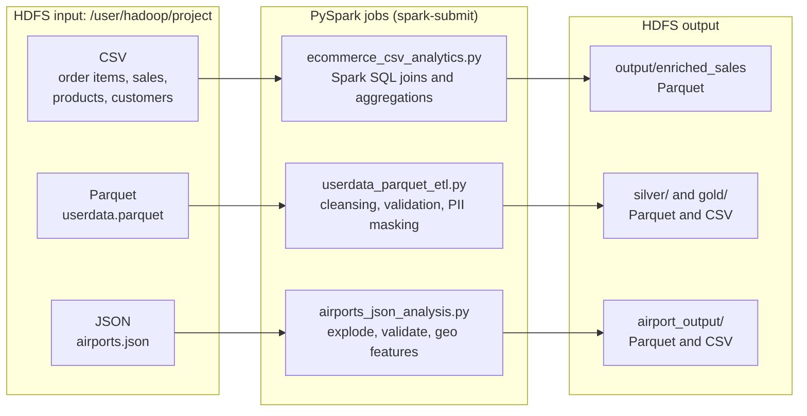

# PySpark Multi-Format ETL on HDFS


Three PySpark pipelines that read **CSV**, **Parquet** and **JSON** data from HDFS, clean and validate it, answer business questions with the DataFrame API and Spark SQL, and write curated results back to HDFS as Parquet, with CSV exports for Excel and Power BI.

## Pipelines at a glance

| Pipeline | Input | What it does | Output |
| --- | --- | --- | --- |
| [`ecommerce_csv_analytics.py`](src/ecommerce_csv_analytics.py) | 4 related CSV files | Joins order items, sales orders, products and customers into one enriched table with Spark SQL, then reports top products, revenue by category, customer segments and the monthly revenue trend | Enriched sales table (Parquet) |
| [`userdata_parquet_etl.py`](src/userdata_parquet_etl.py) | Parquet | Cleans and validates user records, masks credit-card data, engineers features and scores data quality, in a Silver / Gold layout | Silver table + 7 Gold aggregates (Parquet) + 4 CSV exports |
| [`airports_json_analysis.py`](src/airports_json_analysis.py) | Nested, multi-line JSON | Flattens the `airports` array, cleans and de-duplicates airports, validates coordinates and builds geographic features and statistics | Clean airports + 4 analyses (Parquet) + 4 CSV exports |

## Results from a sample run

| Pipeline | Highlights | Full console log |
| --- | --- | --- |
| E-commerce (CSV) | 397,569 order lines enriched with 138,116 orders, 1,175 products and 25,000 customers. Electronics leads revenue by category; the Consumer segment leads revenue by segment. | [ecommerce_output.txt](output/ecommerce_output.txt) |
| User data (Parquet) | 1,000 records and 0 duplicate IDs. `try_to_date` caught 1 unparseable birth date without failing the job. 802 records scored High quality and 198 Medium. | [userdata_output.txt](output/userdata_output.txt) |
| Airports (JSON) | 30 airports with no missing values and no duplicate codes; all 30 coordinates are valid. | [airports_output.txt](output/airports_output.txt) |

## Architecture



## Pipeline details

### 1. E-commerce sales analytics (CSV)

- Reads four CSV files with headers and schema inference: `order_items.csv`, `ecommerce_sales_customer_analytics_150k.csv`, `product_catalog.csv` and `customer_master.csv`.
- Registers each as a temporary view and builds `enriched_sales` with a four-table `LEFT JOIN` in Spark SQL: order item → product, order → sales header, customer → customer master.
- Turns on Adaptive Query Execution and sets 200 shuffle partitions.
- Reports the top 10 products by revenue, revenue and profit by category, customer-segment performance (customers, orders, revenue, average lifetime value) and the monthly revenue trend.
- Writes the enriched table to HDFS as Parquet.

### 2. User data cleansing and quality scoring (Parquet)

- Profiles the raw data (schema, row and column counts) and removes duplicate IDs.
- Standardizes column names and data types, and turns blank strings into `NULL`.
- Parses birth dates with `try_to_date`, so a bad value becomes `NULL` instead of failing the job, then derives age, age group and validity flags.
- Extracts registration date parts, cleans gender, country and title, and extracts the email domain.
- Validates email, IP address, salary and birth date, and flags comments that contain HTML.
- Protects sensitive data: keeps only the last four digits of the credit-card field and drops the raw value.
- Scores every record from 0 to 6 for data quality and labels it High, Medium or Low.
- Analyses users by country, job title salary, gender, age group, registration month, email domain and data quality, plus overall salary statistics.
- Writes the cleaned Silver table (Parquet, snappy), 7 Gold aggregates (Parquet) and 4 CSV exports.

### 3. Airports geographic analysis (JSON)

- Reads a multi-line JSON document and flattens its `airports` array with `explode`.
- Checks for missing codes, names, cities, countries and coordinates, and for duplicate airport codes.
- Trims and upper-cases codes and countries, then removes duplicate codes.
- Validates latitude (-90 to 90) and longitude (-180 to 180), and adds hemisphere, east/west region and a combined location category.
- Counts airports by country, city, hemisphere, longitude region and location category, computes coordinate statistics, and finds the northernmost, southernmost, easternmost and westernmost airports.
- Writes the clean dataset and 4 analyses as Parquet, plus CSV copies.

## Repository structure

```
pyspark-multi-format-etl/
├── src/
│   ├── ecommerce_csv_analytics.py   # CSV: joins + sales analytics (Spark SQL)
│   ├── userdata_parquet_etl.py      # Parquet: cleansing, validation, Silver / Gold
│   └── airports_json_analysis.py    # JSON: flatten, validate, geo analysis
├── data/                            # input datasets
│   └── README.md                    # data dictionary: files, sizes, rows, usage
├── output/                          # console output of a sample run of each pipeline
├── scripts/
│   ├── load_data_to_hdfs.sh         # upload the input files to HDFS
│   └── run_all.sh                   # run the three pipelines with spark-submit
├── requirements.txt
└── README.md
```

## Getting started

### Prerequisites

- Hadoop HDFS running, with the NameNode at `hdfs://localhost:9000`
- Apache Spark 4.1 or later: the Parquet pipeline imports `try_to_date`, which was added to PySpark in 4.1
- Python 3, in a version your Spark release supports

### 1. Load the data into HDFS

The input files are in `data/` (see [data/README.md](data/README.md) for what each one holds). Upload them with:

```bash
bash scripts/load_data_to_hdfs.sh data
```

### 2. Run the pipelines

```bash
spark-submit src/ecommerce_csv_analytics.py
spark-submit src/userdata_parquet_etl.py
spark-submit src/airports_json_analysis.py
```

Or run all three in order:

```bash
bash scripts/run_all.sh
```

### 3. Check the run logs

Each script also saves its full console output to `<pipeline>_output_<timestamp>.txt` in the folder you run it from. These files are ignored by Git; logs from a sample run are kept in [`output/`](output/).

## Outputs

All paths are under `hdfs://localhost:9000/user/hadoop/project/`.

| Pipeline | Path | Format |
| --- | --- | --- |
| E-commerce | `output/enriched_sales` | Parquet |
| User data | `silver/userdata_cleaned` | Parquet (snappy) |
| User data | `gold/country_analysis`, `gold/job_salary_analysis`, `gold/gender_analysis`, `gold/age_analysis`, `gold/registration_analysis`, `gold/email_domain_analysis`, `gold/data_quality_analysis` | Parquet |
| User data | `gold/csv/country_analysis`, `gold/csv/job_salary_analysis`, `gold/csv/gender_analysis`, `gold/csv/age_analysis` | CSV |
| Airports | `airport_output/clean_airports`, `airport_output/country_analysis`, `airport_output/city_analysis`, `airport_output/hemisphere_analysis`, `airport_output/location_analysis` | Parquet (clean airports: snappy) |
| Airports | `airport_output/csv/country_analysis`, `airport_output/csv/city_analysis`, `airport_output/csv/hemisphere_analysis`, `airport_output/csv/location_analysis` | CSV |

## Skills demonstrated

- Reading CSV with schema inference, Parquet, and nested multi-line JSON in Spark
- Spark SQL on temporary views alongside the DataFrame API
- Multi-table joins and aggregations for business reporting
- Data profiling, de-duplication, type standardization and validation rules
- Fault-tolerant parsing of dirty values, PII masking and data quality scoring
- Medallion-style Silver and Gold outputs in columnar Parquet with snappy compression
- HDFS as the storage layer for raw inputs and curated outputs
- Saving every run's console output to a timestamped log for traceability

## Author

**Hager Salah El-dien Youssif**
